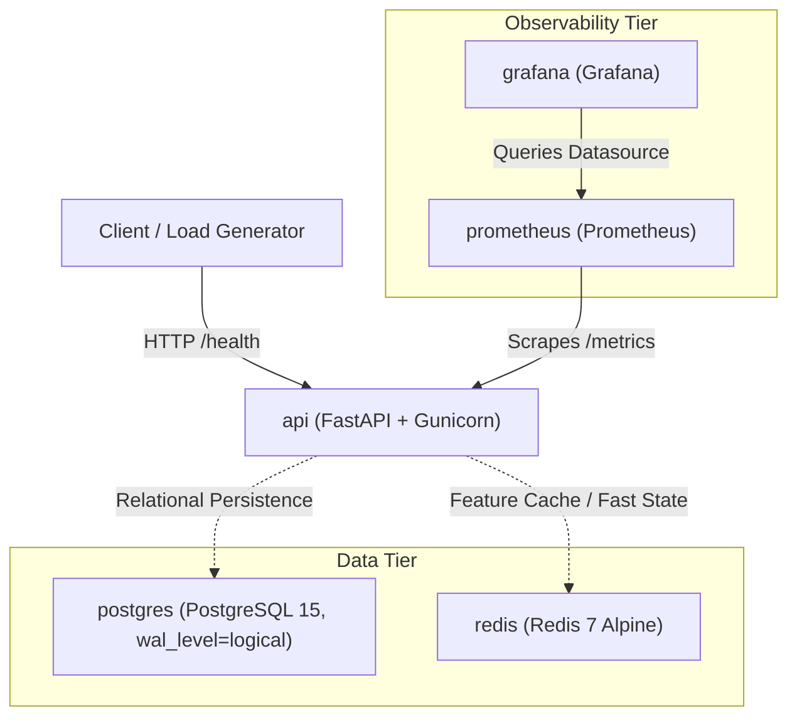

# SYSTEM_DESIGN.md

## 1. The Two-Clock Principle

PROJECT--ashFALL is architected around two fundamentally distinct operational time scales:

```
+-----------------------------------------------------------------------------------+
|                                 FAST CLOCK                                        |
|                          (Scoring Path: Milliseconds)                             |
|                                                                                   |
|  [Transaction Ingress]                                                            |
|          │                                                                        |
|          ▼                                                                        |
|   ┌─────────────┐     Low-latency Cache    ┌──────────────┐                       |
|   │ FastAPI/API ├─────────────────────────►│    Redis     │                       |
|   └──────┬──────┘                          └──────────────┘                       |
|          │                                                                        |
|          ▼                                                                        |
|   Deterministic Decision (Approve / Challenge / Decline)                          |
+------------------------------------------┬----------------------------------------+
                                           │
                                     Async Events
                                           │
+------------------------------------------▼----------------------------------------+
|                                 SLOW CLOCK                                        |
|                       (Investigation Path: Minutes)                               |
|                                                                                   |
|   ┌───────────────────────────────────────────────────────────────────────────┐   |
|   │ Asynchronous Agentic Pipeline & LLM Forensic Analysis                     │   |
|   │  - Multi-hop graph exploration and entity resolution                      │   |
|   │  - Contextual case synthesis, audit logging, and forensic narratives      │   |
|   │  - Human-in-the-loop review orchestration and feedback loops             │   |
|   └───────────────────────────────────────────────────────────────────────────┘   |
+-----------------------------------------------------------------------------------+
```

- **Fast Clock (Scoring Path — Sub-millisecond to Milliseconds, Deterministic)**:
  Every incoming payment or transfer transaction requires an immediate, non-negotiable real-time decision. The fast clock executes strictly deterministic inference (gradient boosted trees, neural nets, feature lookups) with bounded latency targets. No non-deterministic agents, external LLMs, or unbounded network calls ever sit on this critical hot path.
  
- **Slow Clock (Investigation Path — Minutes, Agentic & LLM-Driven)**:
  Once the immediate score is rendered, flagged or high-risk transactions flow asynchronously into the slow clock. Here, intelligent agentic workflows and LLMs perform deep investigative forensics, traverse relational and graph entity topologies, generate audit explanations, and propose fraud pattern updates. This deep analysis runs out-of-band and never degrades transaction throughput.

---

## 2. Current Service Graph (Level 0)

At Level 0, the infrastructure baseline consists of five core containerized services orchestrated via Docker Compose:



- **api (`PROJECT-ashFALL` Web Service)**:
  FastAPI application served by Gunicorn with Uvicorn workers and uvloop. Equipped with GPU passthrough reservations for RTX 4050 acceleration. Emits structured JSON logs containing `timestamp`, `level`, `event`, `environment`, and `request_id`.
  
- **postgres (`PostgreSQL 15`)**:
  Relational data store configured from inception with `wal_level = logical` via container command to enable logical decoding and zero-downtime change data capture (CDC) in subsequent tiers. Data is persisted via the `postgres_data` named volume.
  
- **redis (`Redis 7 Alpine`)**:
  In-memory key-value store serving as the fast-clock cache for entity counters, sliding windows, and deduplication tokens.
  
- **prometheus (`Prometheus`)**:
  Time-series metrics collection server configured to scrape service metrics targets (such as `api:8000/metrics`).
  
- **grafana (`Grafana`)**:
  Visualization engine pre-provisioned with the internal Prometheus instance as its default datasource for real-time telemetry and alerting.

---
