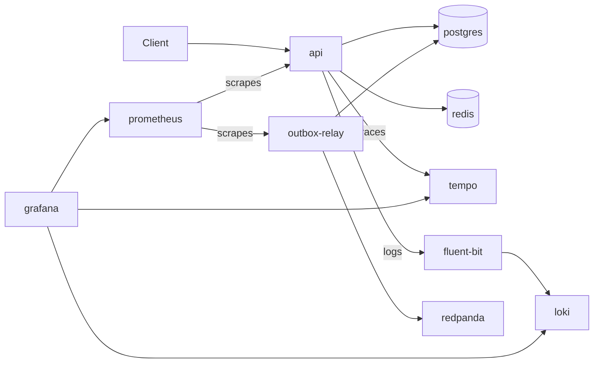

# Architecture Overview (last updated: Level 8)

This page describes how the project is put together today, in plain English. It only states what can be seen in the
code, `docker-compose.yml` and the other docs; anything not confirmed there is marked "unverified".

## What the system is

PROJECT--ashFALL is a fraud scoring service. A client sends a transaction to a web API, the API saves it, and a fraud
score comes back. Around that sit a message pipeline (the outbox, a relay and Kafka-compatible Redpanda), a monitoring
stack, a trained fraud model with its data and training scripts, and a way to prove each level works with one command.

## Folder map

| Folder | What it holds |
|---|---|
| `api/` | the FastAPI web application: `main.py`, `routers/scoring.py`, `middleware/`, `models/health.py`, `dependencies/db.py`, `services/` (outbox, relay, idempotent consumer) |
| `core/` | shared building blocks: `config.py` (settings), `logging.py`, `tracing.py`, `gpu_monitor.py`, `mlflow_setup.py`, `energy_cost.py`, `exceptions.py` |
| `features/` | feature calculations for scoring: `temporal.py`, `velocity.py` (Redis-based), `entropy.py`, `geo_velocity.py`, `gpu_geo_velocity.py` |
| `serving/` | `fraud_client.py` (gRPC client for the Triton-served model) and `model_repository/` (the model files Triton reads) |
| `models/` | model files: `xgboost/`, `calibration/` (tracked by DVC), `dnn/`, `gnn/` (empty placeholders) |
| `data/` | datasets and schemas (`raw/`, `processed/`, `enriched/`, `schemas/`, `adversarial/`); large files are not in Git |
| `migrations/` | numbered SQL files for Postgres (transactions, outbox, processed events, dead letters) |
| `scripts/` | command-line tools: training and evaluation (`fraud_*.py`), data tools, `run_migrations.py`, backup and restore (`backup_mlflow.py`, `restore_mlflow.py`, `verify_dvc_restore.py`), `update_baselines.py`, `check.py` |
| `showcase/` | the "prove it" framework and the Level 7 showcase (`python -m showcase --level 7`) |
| `tests/` | `unit/`, `contract/`, `property/`, `schema/`, `integration/`, `baselines/` |
| `infra/` | configuration for Gunicorn, Prometheus, Fluent Bit, Tempo and the Grafana provisioning |
| `benchmarks/`, `reports/`, `docs/`, `envs/` | benchmark scripts; generated reports; documentation; a pinned training environment list |
| `agent/`, `online_learning/`, `specs/` | purpose not documented in code (the folders are empty) |

## Services and how they connect

`docker-compose.yml` defines 11 services. Only the links below are confirmed in the compose file, the config files or
the code.

- `api` waits for healthy `postgres` and `redis`. It sends logs to `fluent-bit` (Docker logging driver) and traces to `tempo` (an OTLP address in `core/config.py`).
- `outbox-relay` waits for healthy `postgres` and `redpanda`, reads the outbox table and publishes to Kafka (the Redpanda broker).
- `prometheus` scrapes the API and the relay (`infra/docker/prometheus.yml`). `grafana` has Prometheus, Loki and Tempo data sources provisioned.
- `triton` is the model server. It only starts with the `serving` or `gpu` profile. Whether any service calls it today is unverified (`serving/fraud_client.py` is the client for it).
- Unverified: which Grafana dashboards are in use today.

## What happens to a request to /score

1. The API receives `POST /score` with a transaction (amount, account, merchant, device, coordinates, optional `idempotency_key`).
2. Today `/score` is a stub: the fraud score is a random number and no model is called (stated in `api/routers/scoring.py`).
3. The transaction and an outbox event are saved to Postgres in one database transaction, then the API returns the score.
4. Later, the relay publishes the event to Kafka, with retry and backoff.

`GET /health` returns the service status and `GET /metrics` serves Prometheus metrics.

## The outbox in five lines

A transaction and its event are written together, so neither can exist without the other. The relay delivers events to
Kafka in order and marks them as sent only after Kafka confirms. If the same event arrives twice, the idempotent consumer
counts it once. A message that Kafka keeps rejecting is parked in a dead-letter table, and a broker outage never parks
anything. Details: [level-7-outbox.md](level-7-outbox.md).

## Data and models

DVC tracks the enriched PaySim parquet, the model files and the calibrator. A local DVC remote and MLflow backup and
restore scripts exist; see [backup-and-restore.md](backup-and-restore.md). Experiments are logged to a local
`mlflow.db` (SQLite) with artifacts in `mlruns/`. `data/raw/paysim.csv` and `data/processed/` are not in Git or DVC.
PaySim rows are deliberately not loaded into the `transactions` table.

## Testing and CI

`.github/workflows/ci.yml` has five jobs:
- `compose-boot`: lint, type check, boot the whole stack, check `/health`.
- `schema-validation`: the Pandera schema gate.
- `model-quality-gate`: checks the committed metrics, and proves a bad model is rejected.
- `level-showcase`: lint, types, unit tests, Postgres and Redpanda, integration tests, and the Level 7 showcase.
- `pytest-fast`: tests that need no Docker (`unit`, `contract`, `property`, `schema`, `baselines`).

`tests/baselines/` stores saved snapshots (model metrics, calibration bins, API shape, which services have a healthcheck)
so accidental changes fail a test. `make check` (or `python scripts/check.py`) runs the same checks locally; add
`--no-docker` to skip the Docker ones.

## Configuration and feature switches

Settings live in `core/config.py` and are read from environment variables or `.env` (copy `.env.example`). Four feature
switches are declared and default to off: `ENABLE_BANK_INTEGRATION_API`, `ENABLE_MODEL_V2`, `ENABLE_GNN_ENSEMBLE`,
`ENABLE_RESEARCH_AGENT_INTERNET`. Nothing reads them yet.

## Known gaps and not built yet

- `/score` does not use the trained model yet (stub).
- Exactly-once delivery is a later level; delivery is at-least-once.
- A parked (dead-letter) message needs a human decision; there is no replay tool yet.
- The DVC remote is a folder on the same disk, so it does not protect against loss of the laptop.
- CI cannot run `dvc pull` or re-score the model.
- There is no showcase for Level 8 yet.
